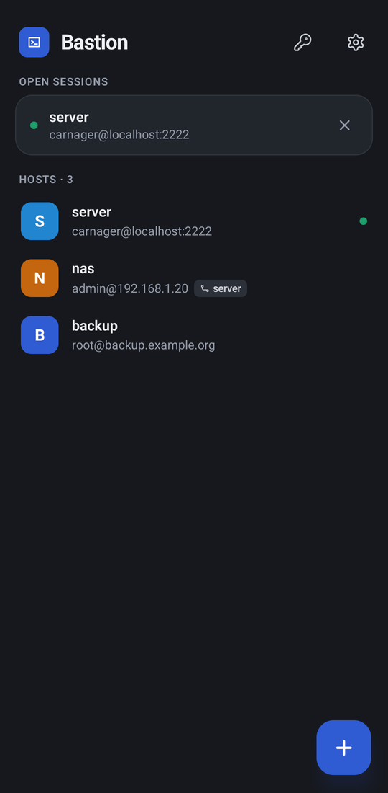
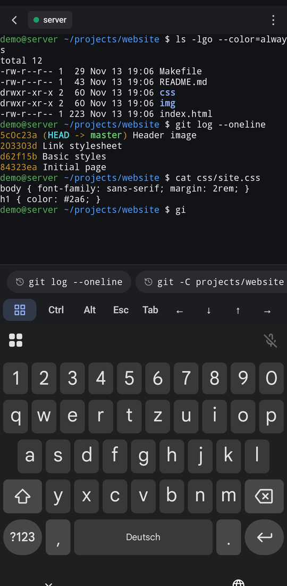
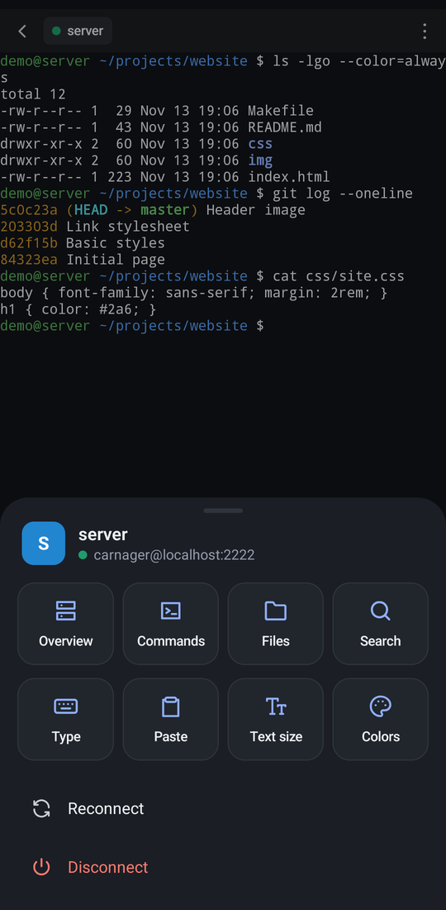
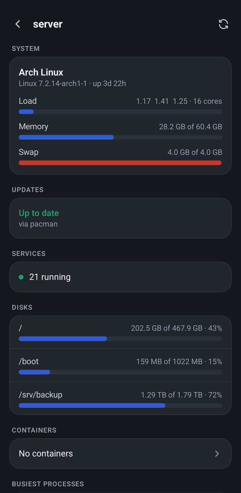
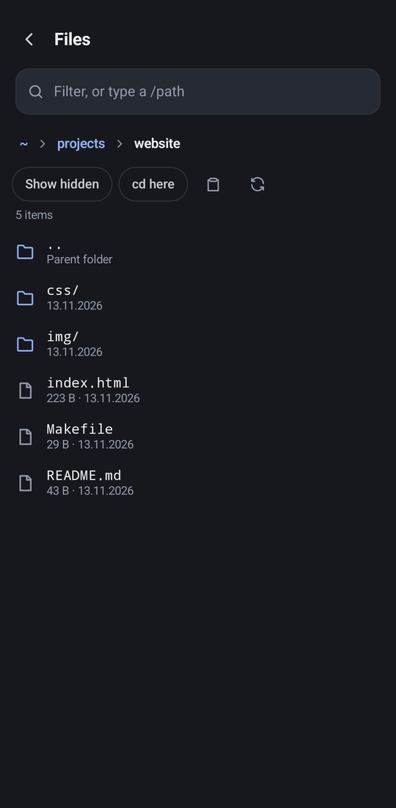
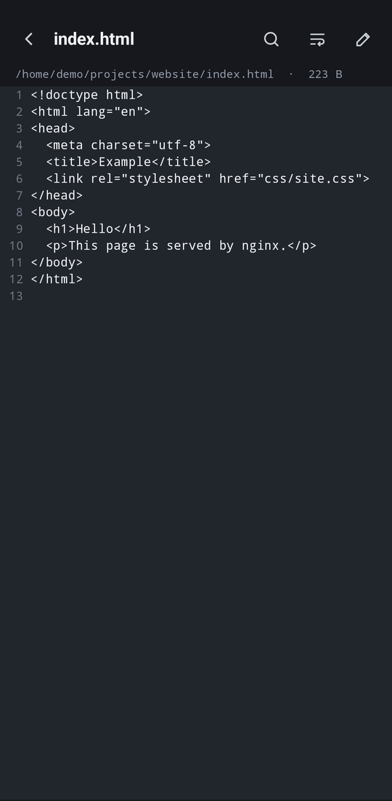
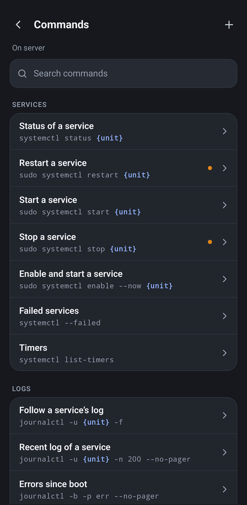
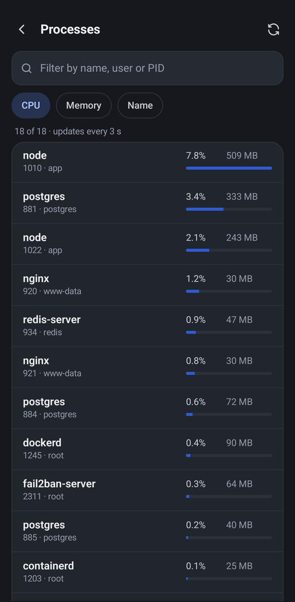
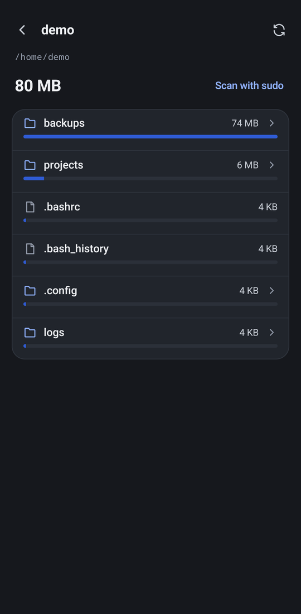

# Bastion

SSH client for Android, made for phone screens. It does jump hosts, and for
the everyday chores (reading a log, checking a service, freeing disk space) it
has real screens, so you don't have to type everything into a tiny terminal.

<p>
  
  
  
</p>
<p>
  
  
  
</p>
<p>
  
  
  
</p>

## Connecting

- Jump hosts, also chained: reach a box on the LAN through your public server.
- Password or key login. Keys can be generated in the app or imported from a
  file (OpenSSH or PEM, passphrases supported).
- Host keys are checked and remembered per host.
- Sessions stay open in the background and reconnect after network changes
  or sleep. Optionally attach to a tmux session, so nothing is lost.
- Optional app lock with fingerprint or screen lock.

## Terminal

- An input line under the terminal with history and suggestions from what
  you typed on that host. Tap a line to edit it there.
- Text size from the menu, not the volume keys. Colour schemes per host.
- Extra keys for Esc, Tab, Ctrl, arrows and the like.
- Search for files, folders, programs or past commands in a proper dialog
  with fuzzy matching, then type or paste the result.
- Sudo prompts are recognised; type the password once per session from a
  button. It is kept in memory only, never saved.

## Beyond the terminal

All of these run over the same connection, next to your shell:

- **Overview**: system, load, memory, disks, failed services, containers and
  pending updates.
- **Files**: browse folders, view and edit text files.
- **Commands**: a list of common commands with fields to fill in (unit,
  path, container, …). Add your own, per host or for all hosts.
- **Services**: status of a systemd unit and its log, readable.
- **Processes**: live list, sort, filter, stop or kill.
- **Disk usage**: what takes the space, folder by folder, with delete.
- **Containers**: Docker or Podman. Start, stop, logs, shell.

Things that need root ask for the sudo password when needed.

Needs Android 11+.

## Build

```sh
./gradlew assembleRelease   # signing: see SIGNING.md
./gradlew test
```

## License

GPL-3.0. Uses [termlib](https://github.com/connectbot/termlib) (ConnectBot's
terminal) and [Apache MINA SSHD](https://mina.apache.org/sshd-project/), both
Apache-2.0.
